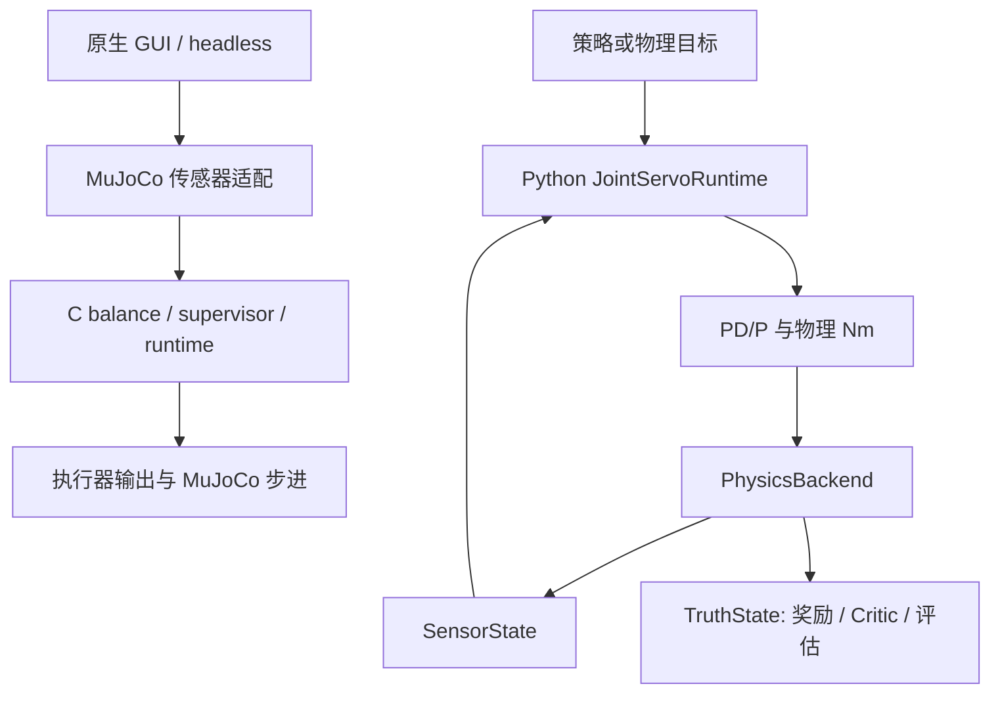

# 代码框架

更新日期：2026-10-20。底层物理接口和控制算法已分开；现有 RL 任务链仍含 MuJoCo 代码。完整单位、传感器与后端契约见[后端分层说明](ROBOT_FRAMEWORK_20261020.md)。

## 模块边界

| 层 | 路径 | 职责与依赖 |
| --- | --- | --- |
| Python 控制核心 | [core](../../scripts/wheel_legged/core/) | NumPy 算法，不导入仿真引擎、Gym 或 SB3 |
| 策略推理 | [policies](../../scripts/wheel_legged/policies/) | Torch 网络，不依赖 SB3 和引擎 |
| 状态与步进协议 | [interfaces.py](../../scripts/wheel_legged/interfaces.py)、[runtime.py](../../scripts/wheel_legged/runtime.py) | 部署传感器与训练真值分开，输出六关节物理 Nm |
| 物理适配 | [backends](../../scripts/wheel_legged/backends/) | 引擎读写、执行器索引、安装标定与物理推进 |
| 现有 RL 任务 | [scripts](../../scripts/) 中的 `spin_*_env.py` | 地形、接管、课程、奖励组合、VecEnv；尚未整体移植 |
| 训练与评估入口 | `train_spin_rl.py`、`eval_spin_rl.py`、`run_spin_rl_gui.py` | PPO 更新、模型导出、固定工况评估和回放 |
| C 控制核心 | [balance](../../control/balance/)、[controllers](../../control/controllers/)、[runtime](../../control/runtime/) | 原生平衡与输出分配，使用传感器契约 |
| C 仿真应用 | [app](../../control/app/)、[sim](../../control/sim/) | MuJoCo、GLFW、GUI 与无界面循环 |
| 参数与资产 | [config](../../config/)、[model](../../model/) | 伺服参数、固定几何标定、MJCF 与网格 |
| 开发工具 | [scripts/tools](../../scripts/tools/)、[tools](../../tools/) | 辨识、测试、仓库检查及日志分析 |

## 两条运行链

第二条是新物理接口的参考管线；既有 `spin_*_env.py` 没有全部改为使用它。原生 GUI 与 Python RL GUI 也是不同入口，不能通过启动原生 GUI 证明 RL 已接管。

六电机顺序、关节方向和 Nm 单位以[机器人契约](../../scripts/wheel_legged/core/robot.py)为准。连杆虚功映射放在 `core/wrench.py`，引擎增益换算放在后端。Actor 只接收可部署传感器；世界位置、速度及接触真值只能用于训练监督、奖励或评估。

## 兼容与维护

保留 `spin_joint_pd.py`、`spin_leg_geometry.py`、`spin_wrench_control.py`、`spin_imu.py` 等旧导入位置；它们复用新核心。保留训练脚本路径和环境类模块名，避免已有 checkpoint 的序列化引用失效。

`pyproject.toml` 只安装 `wheel_legged`，基础依赖为 NumPy，`policy` 可选依赖提供 Torch。MuJoCo/mjbatch/SB3 训练依赖单独在 [requirements-mjbatch.txt](../../scripts/requirements-mjbatch.txt)。模型和标定文件由调用者传入，不依赖安装目录或工作目录自动猜测。

新增引擎适配放入 `backends/`，算法放入 `core/`，网络放入 `policies/`。Isaac 后端还需验证闭链约束、关节轴、IMU、接触和 GPU 批处理，不能直接把 MuJoCo ctrl 当成 Nm。详见[迁移边界](ROBOT_FRAMEWORK_20261020.md#5-isaac-sim--isaac-lab-接入边界)。

## 验证入口

仓库根目录 `make check` 检查文档链接、核心导入边界与 C 可移植性；`make test-core` 检查核心行为与 MuJoCo 对照；`make backend-smoke` 验证物理接口能实际推进。它们不代表整车平衡或斜坡训练验收通过。

全部实验结果从[日志总目录](../logs/README.md)查找。
