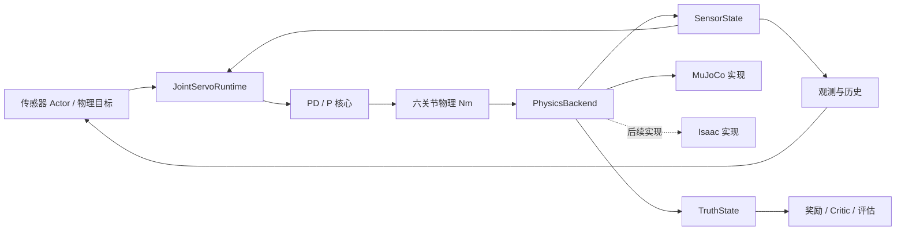

# 控制与仿真后端分层

日期：2026-10-20。目标是让控制算法、几何、观测、奖励和推理网络不依赖 MuJoCo，为后续接入 Isaac Sim/Isaac Lab 保留明确接口。本次完成抽取和 MuJoCo 参考适配，未安装或验证 Isaac，也未开始新一轮 RL 训练。

## 1. 目录与职责

```text
scripts/
  wheel_legged/
    core/
      robot.py             关节顺序、单位、物理保护限值
      actuation.py         腿位置 PD、轮速度 P，输出关节 Nm
      geometry.py          编码器闭链运动学，仅接收标定数据
      wrench.py            Jacobian/虚功与轮支架反作用映射，输出 Nm
      frames.py            坐标、四元数、姿态与 Euler 角速度
      observations.py      25 维观测组装、历史缓冲
      rewards.py           pitch 奖励密度，不读取仿真状态
    policies/
      networks.py          纯 Torch 历史网络与传感器 Actor，无 SB3/仿真导入
    interfaces.py          SensorState、TruthState、PhysicsBackend 协议
    runtime.py             物理目标 -> PD/P -> Nm -> backend.step()
    provenance.py          同时记录抽取实现与兼容入口的源码哈希
    backends/
      mujoco_model.py      模型关节/执行器索引、标定提取、ctrl 换算
      mujoco.py            MuJoCo/mjbatch 状态读写、重置与推进
  spin_*.py                原任务/训练框架与兼容入口
  tools/
    export_robot_calibration.py
    check_physics_backend.py
    test_physics_framework.py
config/
  rl_joint_pd.json          既有 PD/P 参数，不在此次重构中重新调参
  v3_robot_calibration.json 导出的固定几何/安装标定
```

`core` 只需要 NumPy；推理网络单独依赖 Torch。它们以及公共接口和运行循环在禁止导入 `mujoco`、`mjbatch`、`gymnasium`、`stable_baselines3` 的独立进程中实际执行过。



图中的 Isaac 是待接入方向，不是已存在的适配器。现有 residual/wrench 训练入口仍保留其历史任务与动作定义。

## 2. 公共数据契约

### 关节与单位

六电机统一顺序：

```text
Left_front_joint, Left_rear_joint, Left_Wheel_joint,
Right_front_joint, Right_rear_joint, Right_Wheel_joint
```

角度 rad、角速度 rad/s、长度 m、时间 s、力矩为作用到该关节自由度上的 Nm。左右轮电机正负号按各自关节轴，不在后端偷偷变成“前进/转弯”命令。高层物理目标到电机方向的映射由控制/动作分配层决定。

四腿取通道 `[0,1,3,4]`，两轮取 `[2,5]`。历史 25 维观测中的六关节速度顺序仍为 `[LF,LR,RF,RR,LW,RW]`，与六电机输出顺序不同；观测组装时显式重排。

控制机体系为 x 前、y 左、z 上；世界系 z 上；四元数为 `wxyz`，表示 world-from-control。旧模型的 CAD/IMU 安装旋转留在 MuJoCo 适配层。连杆核心使用前/上平面坐标，左右镜像由几何标定给定。

### 传感器与真值分离

`SensorState` 只含编码器位置/速度、校准后的姿态、机体角速度、IMU specific force。数组均带 `(N,...)` 批次维，读取返回快照，后续仿真写入不会改动已取出的观测。

`TruthState` 单独提供机体原点世界位置/线速度与实际关节力矩，用于训练或评估。Actor 观测函数不接收该对象。当前接口不包含接触和地形真值；后续需要时应扩展训练专用结构，不把它们塞进传感器字段。

`projected_up` 是世界 **+Z** 在机体系中的投影，水平时 `[0,0,+1]`。它保留当前策略的符号，与部分 Isaac/Fudan 任务使用的向下 projected gravity 不同。新后端必须匹配策略元数据，不能把两者同名替换。

### 后端协议

| 方法 | 职责 |
| --- | --- |
| `read_sensors()` | 返回部署可获得的传感器状态 |
| `read_truth()` | 返回训练/评估真值，调用方显式选择 |
| `apply_joint_torque(torque_nm)` | 接收 `(N,6)` 物理力矩，后端执行索引与驱动换算 |
| `step()` | 推进一步 `dt`，随后读取反映新状态 |
| `reset(ids)` | 只重置指定实例，包括驱动/求解状态 |
| `close()` | 释放后端资源，可重复关闭 |

MuJoCo 实现通过关节名定位执行器，支持引擎内执行器顺序变化。它只接受直驱固定增益力矩模型，拒绝有隐藏 bias/激活动力学或引擎限幅会截断请求的配置。重置参考 home keyframe，并把历史散布球移远，作为平地物理接口验证；它不做原控制器预热，也不提供已稳定姿态保证。

为满足读后状态契约，新后端在 `mj_step` 后执行 `forward` 刷新传感器。历史训练环境保持原先的采样时序，没有借重构改变旧 checkpoint 的观测延迟。

## 3. 复用算法与兼容旧入口

`spin_joint_pd.py`、`spin_leg_geometry.py`、`spin_wrench_control.py` 保留原构造及返回值，实际算法调用 `core`。旧的 `spin_imu.py` 也保留安装标定与姿态函数的导入路径。

核心 PD 的 `control()` 返回 `(physical_torque, requested_torque)`；旧台架接口仍返回 `(mujoco_ctrl, physical_torque, requested_torque)`。核心 wrench 映射不再返回 `ctrl`，兼容包装器补上它。只在后端/兼容包装中执行 MuJoCo 增益换算。

`spin_wrench_env.py` 已使用抽取的紧凑观测函数和 pitch 奖励；姿态函数从核心复用。历史策略网络从 `policies/networks.py` 复用，SB3 策略与 PPO 更新继续留在原训练适配文件中，参数名称和网络层布局保留。

不能把此次模块抽取视为新 RL 系统已完成：原 V2-V9 地形、课程、接管和 SB3 VecEnv 仍在 `spin_*_env.py` 继承链中，含 MuJoCo 绑定。新后端没有假装包装并迁移这些旧训练任务。

本次也没有更改原 25×6 历史模型的契约、wrench 动作语义或 encoder 训练方式。新的 5 帧历史类明确将当前帧计入总数，验证工具使用它得到 125 维；它不是新的已训练策略。

## 4. 标定导出与无 MuJoCo 使用

固定几何从模型提取一次，保存为普通 JSON：

```bash
.venv-mjbatch/bin/python scripts/tools/export_robot_calibration.py \
  --out config/v3_robot_calibration.json
```

在不安装 MuJoCo 的进程中，可直接使用核心：

```python
import json
import numpy as np
from wheel_legged.core.geometry import EncoderLegGeometry
from wheel_legged.core.actuation import JointPDGains, JointTargetPD

calibration = json.load(open("config/v3_robot_calibration.json"))
geometry = EncoderLegGeometry(calibration["leg_sides"])
gains = JointPDGains.load("config/rl_joint_pd.json")
servo = JointTargetPD()
q = np.zeros((1, 6))
tau, requested = servo.control(q, q, np.zeros((1, 4)),
    np.zeros((1, 2)), gains, np.zeros((1, 6)), .001)
```

从仓库根目录导入时可设置 `PYTHONPATH=scripts`，或通过现有脚本入口运行。后续目录整理已补充根目录 `pyproject.toml`，也可用 `python3 -m pip install -e .` 安装独立核心，`.[policy]` 额外安装 Torch；不会自动安装 MuJoCo 或 SB3。模型与 JSON 路径仍由调用者显式提供。

导出 JSON 中的 `mujoco_ctrl_to_joint_nm`、`mujoco_attitude_to_site_wxyz` 是 **MuJoCo 适配元数据**。Isaac 应按导入后模型的实际关节/传感器坐标配置，不可把这些值直接当成 PhysX 驱动增益。XML 哈希记录标定来源，不代表所有 mesh/材质资产的完整物理指纹。

## 5. Isaac Sim / Isaac Lab 接入边界

| 可以复用 | 必须适配或验证 |
| --- | --- |
| 物理 Nm、关节命名与方向约定 | USD/URDF 导入后的关节轴、默认角与拓扑 |
| PD/P 公式和已保存的参数基线 | PhysX 接触、惯量、阻尼与数值步长下是否仍稳定 |
| 无模型访问的几何与虚功公式 | 闭链不能当普通开链树导入，需重建并核对约束 |
| 观测布局、归一化与历史定义 | 四元数排列、up/gravity 符号、IMU 参考系和采样延迟 |
| 纯 Torch Actor 推理模块 | 新任务与算法的训练接口，旧 checkpoint 的输入/动作契约 |
| 真值与部署输入分离原则 | Isaac 的接触/地形特权量和域随机化实现 |

建议后续 RL 环境优先基于 Isaac Lab 的向量化任务接口，Isaac Sim 提供物理与场景。若用这里的外部 PD/P 产生力矩，必须关闭相应关节的内部位置/速度 drive，避免 PhysX drive 与外部控制器重复作用。Isaac 力矩 API 接收 Nm 时直接传 `tau`；不要再次除以 MuJoCo 的 50/10。

**当前公共运行循环和算法参考实现是 NumPy/CPU，并不是 GPU 训练环境。** 这能用于 Isaac 的小规模接口校验；大规模训练需在同一物理契约下实现 Torch/device 批处理，不应每 1 ms 调用 `.cpu().numpy()`。`policies/networks.py` 本身支持 Torch device，几何/观测/PD 的 GPU 实现尚未完成，本次未用空适配器冒充完成。

迁移顺序建议：先核对空载关节方向与单位，再验证闭链和支架转动，再复测已确定的 PD/P 伺服参数，然后做自由机体平地任务，最后迁移地形、接管与随机化。相同参数不保证两个引擎有相同闭环行为。

## 6. 已执行验证

```bash
.venv-mjbatch/bin/python scripts/tools/check_physics_backend.py --envs 4 --ticks 100
.venv-mjbatch/bin/python -m pytest -q scripts/tools/test_physics_framework.py
```

物理接口检查实际推进 0.1 秒，4 实例、5×25=125 维历史、所有读取有限，最大力矩 7.5 Nm；没有 native 控制或 RL 更新。这是运行管线检查，不是平地平衡结果。

新增测试检查：禁止仿真/训练依赖时核心与运行循环仍可执行、离线标定与模型提取结果一致、观测数值和顺序不变、局部历史重置、执行器重排、后端输出与独立 MuJoCo 逐步轨迹一致、局部物理重置、快照隔离、真值不进入观测以及异常力矩拒绝。

相关旧回归覆盖 PD/P、虚功与 Jacobian、左右滑移、RL/native 互斥、网络训练/保存/导出、GUI 与训练一致性及地形/奖励/回归行为。具体测试结果与未完成事项同时追加到调试总日志。

本轮两组共 **97 项通过**（53 项核心/后端/控制/网络/GUI，44 项地形/奖励/回归），修改独立进程隔离测试后再次运行新增的 7 项也全部通过。存在原有 TorchScript 弃用提示，无失败。语法检查、核心依赖边界检查、文档链接检查与 `git diff --check` 均通过。
